# ResearchPilot architecture and roadmap

## Scope and principles

ResearchPilot accepts only a topic or research question. Scholarly discovery is API-first (Semantic Scholar primary; OpenAlex fallback/coverage source), never Google Scholar scraping. It preserves provenance, honours access restrictions, explicitly scopes negative claims, and does not present an unvalidated candidate gap as a fact.

## Data flow

```mermaid
flowchart LR
 Q[Research question] --> P[Planner]
 P --> S[Scholarly API fan-out]
 S --> M[Normalize, merge, deduplicate]
 M --> R[Hybrid rank]
 R --> T[Accessible-text retrieval]
 T --> E[Structured evidence]
 E --> C[Cross-paper comparison]
 C --> G[Candidate gaps]
 G --> V[Counter-evidence search and validation]
 V --> D[Resources and directions]
 D --> F[Grounded report]
```

## Agent graph

LangGraph is introduced in Phase 2 when it provides durable, inspectable state and retries. Nodes have explicit contracts: Planner (`question -> SearchPlan`), Discovery (`SearchPlan -> RawPaper[]`), Expansion (`Paper[] -> RawPaper[]`), Ranker (`Paper[] -> RankedPaper[]`), Retrieval (`Paper -> Document`), Extractor (`Document -> Evidence[]`), Synthesizer (`Evidence[] -> Landscape`), Gap generator (`Landscape -> CandidateGap[]`), Validator (`CandidateGap -> Validation`), Resource discovery (`Direction -> Resource[]`), Citation validator (`Report -> validated report`). Each node records failures and never substitutes invented output.

Phase 1 implements the first four nodes synchronously behind a stable job/session contract. A queue worker takes over long-running execution in Phase 2.

## Storage schema

PostgreSQL production tables: `projects`, `research_queries`, `analysis_sessions`, `papers`, `paper_sources`, `authors`, `paper_authors`, `citations`, `paper_chunks`, `evidence`, `methods`, `datasets`, `metrics`, `limitations`, `future_work`, `research_gaps`, `gap_evidence`, `resources`, and `research_directions`. `paper_sources` retains source identifiers and raw URLs separately from canonical records. Qdrant stores chunk embeddings keyed by immutable chunk ID and paper ID. Redis carries jobs/caching. SQLite is used only for Phase-1 local development.

## Current module alignment

1. **Research Query Planning:** deterministic planner or Gemini query expansion; output is an inspectable `SearchPlan`.
2. **Scholarly Discovery:** Semantic Scholar, OpenAlex, and Crossref API fan-out with per-source status.
3. **Deduplication and Verification:** DOI/title canonicalization; Crossref metadata enrichment; independent relevance and verification signals.
4. **Paper Processing:** provenance-preserving abstract-level method/dataset/metric/result/limitation extraction. Full-text processing is intentionally not claimed until an accessible PDF has been retrieved and parsed.
5. **Evidence Retrieval:** current evidence is extracted from available abstracts; full-text RAG is planned.
6. **Knowledge Layer:** typed structured records and comparison matrices are persisted inside the analysis session; Markdown/YAML OKF export remains planned.
7. **Cross-paper Analysis:** method, dataset, metric, and limitation matrices are generated from structured records.
8. **Gap Validation:** each potential gap launches a source API counter-search; candidate state is updated to countered/refined or scoped-potential. No result is a global novelty claim.
9. **Resources:** GitHub API lookup plus evidence-linked dataset and technology suggestions.
10. **Directions/Workspace:** evidence-linked research directions and the interactive session workspace.

### Signal semantics

The workspace deliberately does **not** show a generic “paper quality” score. Each paper shows three separate signals: (1) relevance, from the current lexical/metadata ranker; (2) scholarly verification, from source/DOI/venue/author/abstract agreement; and (3) evidence traceability, the mean score of the exact extracted claims. Traceability is calculated only from observable properties—available source passage, DOI, source verification, open-access link, and passage length. It measures how readily the displayed claim can be checked, not whether the claim is scientifically true. Every rendered evidence item retains its raw passage, source URL, category, and `abstract` evidence level.

## Phase-1 API contract

`POST /api/v1/research-sessions` takes `{ "question": string, "max_results": 5..50 }` and returns a complete discovery session: generated plan, ranked papers, source status, counts, and timestamp. `GET /api/v1/research-sessions/{id}` returns that immutable session. `GET /health` reports service status. Failures of individual databases remain visible under `source_status`; at least one successful source is required for success.

## Retrieval strategy

Candidate corpus = independent query variants × scholarly sources, then canonical normalization and DOI/Semantic Scholar/title fingerprint deduplication. Phase 1 uses deterministic lexical relevance (title weighted 2.0, abstract 1.0), citation impact `log1p(citations)` normalized within corpus, and recency decay. This is deliberately explainable. Phase 2 will benchmark BM25 + scientific embedding candidates (SPECTER2, E5, BGE) + metadata filters, then a cross-encoder reranker using Recall@K, MRR, nDCG and latency—not a blindly selected model.

## Gap algorithm and validation

Structured evidence builds method×dataset, method×metric, method×domain, model×dataset, limitation, future-work, and result comparison matrices. Rules propose typed candidates only when supported by multiple records. Each candidate generates adversarial counter-queries and explores citations/recommendations. Validation labels it `validated`, `countered`, or `insufficient`; reports say “within the analysed corpus and search scope,” never global novelty.

## Resource and citation validation

Resource discovery uses GitHub, dataset registries and model hubs through their official APIs. URLs are checked, GitHub metadata/README/license are fetched, and paper association must be explicit or marked community. Important report claims must link to evidence chunks carrying paper, section/page (when full text), exact source URL/DOI, confidence, and entailment result. Unsupported claims are removed or marked insufficient evidence.

## Evaluation methodology

Build an expert-annotated topic set with relevant papers, claim/evidence pairs, known gaps and resource judgments. Compare LLM-only, basic RAG, RAG+rereanking, structured-evidence RAG, and the proposed counter-validated system. Measure retrieval Recall@K/Precision@K/MRR/nDCG; citation correctness/completeness/entailment; synthesis correctness/coverage/relevance; gap precision/recall/F1/false-gap rate/expert agreement; resource validity/relevance/usefulness. Pre-register source coverage and report error bars.

## Roadmap

1. **Delivered:** planning, multi-source automatic discovery, normalization, deduplication, explainable ranking, API/UI/tests.
2. Accessible OA retrieval, PDF parsing, chunk and structured evidence extraction.
3. Comparison matrices, grounded landscape and citation graph expansion.
4. Candidate gaps, counter-search, validation, abstention-aware reports.
5. Verified repositories/datasets/models and research-direction/experiment design.
6. Background workers, PostgreSQL/Qdrant, LangGraph checkpoints and production auth.
7. Interactive literature map.
8. Benchmark/evaluation suite and expert study.
